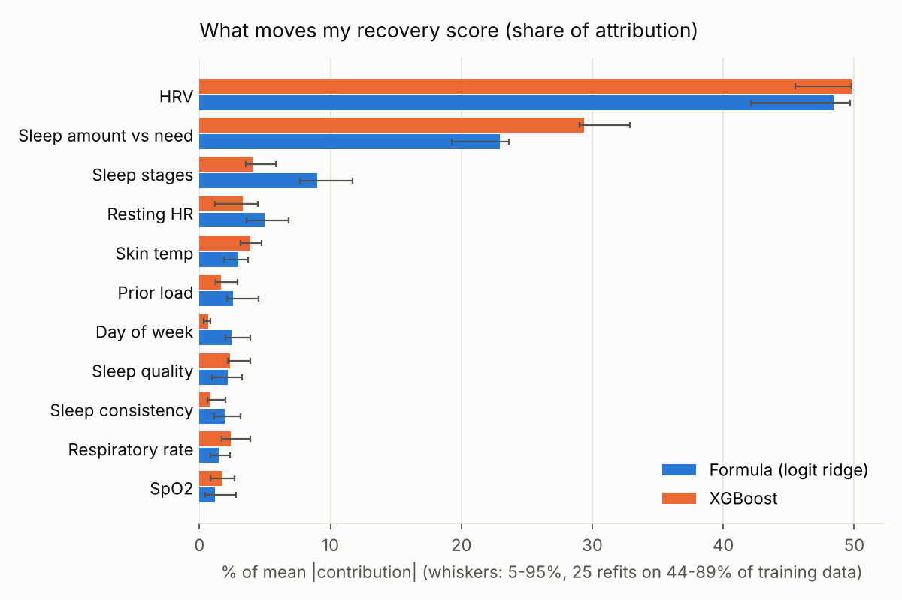

# whoop-reverse-recovery

WHOOP's coach tells you why your recovery moved and ranks the drivers, but it gives no numbers and
no way to check the ranking. This project pulls **your own** data through the WHOOP API, rebuilds the
recovery score with a model, and splits every score (and every day-over-day change) into recovery
points per input. Then it looks for what the app doesn't show you: where the score bends, which kinds
of days cost you, and whether an irregular bedtime matters.

Everything runs locally against your own WHOOP account. Nothing is hosted, and no data or tokens
leave your machine.



## Findings (worked example: one person, 423 usable mornings over ~15 months)

- **HRV carries about half of the score, and sleep vs. sleep need about a quarter.** The two models
  (a readable logit-link "formula" and XGBoost) agree: HRV 48% / 50%, sleep amount vs need 23% / 29%.
  The ranking is identical in all 25 stability refits.
- **Resting heart rate barely registers (3-5%) once HRV is in.** RHR moves with HRV, so HRV likely
  absorbs its effect. That's a credit-splitting limit, not proof WHOOP ignores RHR.
- **The biggest misses show the score's shape.** Nights under 4 h score ~11 points lower than a smooth
  formula predicts. Past ~9 h of sleep, or with HRV more than 30% above baseline, the extra credit
  seems to stop. That fits WHOOP capping how much credit sleep and HRV can earn.
- **An irregular bedtime showed no measurable cost** once sleep length and quality are counted. The test
  was pre-registered and failed: a typical swing in bedtime costs at most ~1.4 points.
- **Busy days are followed by ~15 points lower recovery**, but all of it runs through the shorter night
  and lower HRV that follow. Nothing is left over once the model sees those.
- **One rule recovered exactly:** WHOOP's "sleep need from recent nap" equals minus the previous day's
  nap length, to the millisecond.

Held-out accuracy (54 mornings after a device gap, pre-registered thresholds, not blind):

| Model | MAE (points) | R² |
|---|---|---|
| XGBoost | 5.7 | 0.89 |
| Readable formula (ridge on logit(recovery/100)) | 6.6 | 0.82 |
| Always predict the mean | 16.9 | 0.00 |

Details: [`results/m2_summary.txt`](results/m2_summary.txt) (attribution, formula) and
[`results/m3_summary.txt`](results/m3_summary.txt) (anomalies, bedtime test, kinds of days).

## Try it on your own data

You need Python 3.10+, git, and a WHOOP membership with at least ~3 months of history.
Setup takes about 10 minutes.

1. **Register a free app** at the [WHOOP developer dashboard](https://developer-dashboard.whoop.com).
   Set the redirect URL to `http://localhost:8000/callback` and tick all the read scopes plus `offline`.
   It's only for you; nobody else needs access.
2. **Get the code and install:**
   ```bash
   git clone https://github.com/michaeldanial0910/whoop-reverse-recovery.git
   cd whoop-reverse-recovery
   python -m venv venv && source venv/bin/activate      # Windows: venv\Scripts\activate
   pip install -r requirements.txt
   ```
3. **Add your app's keys** to a file called `.env` in that folder:
   ```
   WHOOP_CLIENT_ID=your-client-id
   WHOOP_CLIENT_SECRET=your-client-secret
   ```
4. **Run everything:**
   ```bash
   python run.py
   ```
   A browser tab opens for the WHOOP login, your history downloads, the analysis runs (a couple of
   minutes), and the dashboard opens at `http://localhost:8501`.

Later: `python run.py` again pulls new days and refreshes everything. `python run.py --skip-sync`
re-runs the analysis without downloading.

**What the dashboard shows:** a one-minute summary; any morning's score split into points per input,
including the move from the day before (the thing the coach explains in words); the model's track
record; your kinds of days; surprising mornings; the bedtime test; and a what-if panel ("+1 h sleep").
Every number and sentence comes from your own data. The findings above are mine; yours may differ.

**Your test split:** on the first run, the last 15% of your mornings are held out as a test set and
the dates are saved to `data/split.json`. Later runs keep that test set frozen, and new mornings go
into a "forward" set the model has never seen. To pin your own dates, edit that file.

## Method

- One row per WHOOP cycle, local time. Personal baselines (HRV, RHR, respiratory rate, skin temp) use
  only the previous 30 days.
- Time-based hold-out with the pass thresholds pre-registered before evaluation (`preregistration*.json`).
  A near-perfect fit (R² ≥ 0.97) counts as a leakage alarm, not a success.
- Attribution: exact grouped Shapley values over 11 input groups, against one fixed reference, in
  recovery points. Each morning's contributions sum exactly to the prediction minus the reference, and
  day-over-day differences sum exactly to the change.
- Anomalies: out-of-fold residuals; a morning is flagged at 2.5 × the robust SD.
- Bedtime test: pre-registered OLS with moving-block bootstrap and Holm correction. It reports the
  total effect (controlling sleep amount and quality) and the direct effect (also HRV/RHR).
- Kinds of days: k-means on strain, number of activities and hours slept; k picked by silhouette.

## Limits

- One person's data and an approximation of a proprietary score, not WHOOP's formula.
- Attribution describes the model, not causes. "HRV accounts for 48%" doesn't mean raising HRV by any
  means raises recovery that much.
- The test set is not blind: it was looked at during M2 development.
- On the first 12 mornings after the model was frozen, error is higher (MAE 8.9) and the model
  over-predicts by ~8 points. That's too few days for a verdict; weekly forward testing will tell.
- WHOOP's own sleep-need number is an input, so part of its logic is inherited, not reconstructed.

## Privacy

`.env`, `.whoop_tokens.json` and everything under `data/` are git-ignored. Only summary tables and
figures in `results/` are meant to be shared. Per-day tables stay in `data/processed/`.

## Layout

```
run.py              one command: login -> sync -> analysis -> dashboard
app.py              Streamlit dashboard (reads data/processed and results/)
src/login.py        WHOOP OAuth with a local callback (auth.py + get_tokens.py: manual fallback)
src/sync.py         incremental sync with token refresh, retries and atomic writes
src/features.py     per-cycle features, baselines, exclusions, test split
src/train_baselines.py, src/attribution.py, src/m3_*.py   models, attribution, M3 analyses
notebooks/          exploration, one per milestone
results/            summaries and figures (the worked example)
```

Exact package versions used in development (Python 3.14, macOS): `requirements-lock.txt`.
A macOS daily-sync template: `scripts/com.whoop-reverse-recovery.sync.plist.template`.
